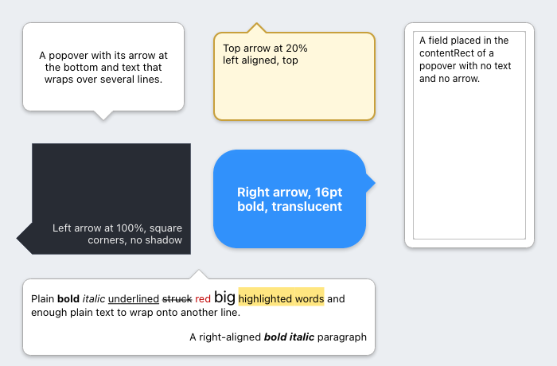

# hxtPopover

A popover widget for [HyperXTalk](https://github.com/emily-elizabeth/HyperXTalk), written in LiveCode Builder. It draws a rounded bubble with an arrow on one side and, optionally, styled text inside it. Everything is set from the property inspector or from script.

It is the successor to [skPopover](https://github.com/stam66/skPopover), which did the same job with a group of controls and a settings palette.



## Using it

Build the extension (see below), install `build/com.hyperxtalk.widget.popover.lce` with the Extension Manager, then drag a Popover from the Tools palette.

A popover can be used in two ways:

- **With its own text.** Type and style the text in the Contents tab of the property inspector, or set it from script.
- **As a backdrop for other controls.** A widget cannot contain controls, so leave the text empty, place the controls over the widget and group them with it. The `contentRect` property says where the inside of the bubble is:

  ```
  set the rect of field "Details" to the contentRect of widget "Popover"
  ```

A widget only sees clicks inside its own rectangle, so dismissing a popover when the user clicks elsewhere is left to your scripts.

## Properties

| Property | Values | Default |
|---|---|---|
| `styledText` | array, in the layout of a field's `styledText` | empty |
| `text` | plain text; setting it removes any styles | empty |
| `textAlign` | `left`, `center`, `right` | `center` |
| `textVerticalAlign` | `top`, `center`, `bottom` | `center` |
| `arrowSide` | `left`, `top`, `right`, `bottom`, `none` | `bottom` |
| `arrowPosition` | 0 to 100, percent along the side | 50 |
| `arrowSize` | pixels | 12 |
| `cornerRadius` | pixels | 10 |
| `lineSize` | pixels, 0 for no outline | 1 |
| `contentMargin` | pixels between the outline and the content | 10 |
| `showShadow` | `true`, `false` | `true` |
| `fillColor`, `lineColor`, `fontColor` | `r,g,b` or `r,g,b,a`, each 0 to 255 | white, grey, black |
| `contentRect` | read-only, `left,top,right,bottom` in card coordinates | |

Notes:

- The text colour is `fontColor`. `textColor` is the engine's own synonym for `foregroundColor` and does not reach the widget.
- Text with no style of its own uses the widget's `textFont`, `textSize` and `textStyle`.
- With `showShadow` on, the bubble is drawn 8 pixels inside the widget's rectangle to leave room for the shadow.

### Styled text

Styled text can be copied straight from a field:

```
set the styledText of widget "Popover" to the styledText of field "Source"
```

The widget draws the font, size, colour, background colour, bold, italic, underline and strikeout of each run, and the alignment of each paragraph. Links, lists, indents, tabs, images and superscript or subscript are kept in the array but not drawn. Text is wrapped to the content area and clipped if it does not fit.

## Building

`build.sh` compiles `popover.lcb` with the `lc-compile` from a HyperXTalk source checkout and zips the extension:

```
HXT=/path/to/HyperXTalk ./build.sh
```

`HXT` defaults to `~/Developer/HyperXTalk`, and the script expects a macOS Release build under `_build/mac/Release`.

## Testing

```
test/run.sh
```

runs the widget in a headless engine, checks its properties, saves and reloads a stack, and writes snapshots to `build/test`.

## Limitations

- Developed and tested on macOS only.
- The default colours are fixed and do not follow dark mode.

## Licence

MIT. See [LICENSE](LICENSE).
