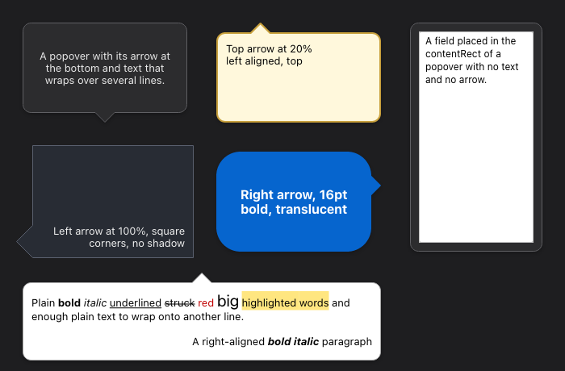

# hxtPopover

A popover widget for [HyperXTalk](https://github.com/emily-elizabeth/HyperXTalk), written in LiveCode Builder. It draws a rounded bubble with an arrow on one side and, optionally, styled text inside it. Everything is set from the property inspector or from script.

It is the successor to [skPopover](https://github.com/stam66/skPopover), which did the same job with a group of controls and a settings palette.


## Installing

1. Download `com.hyperxtalk.widget.popover.lce` from the [latest release](https://github.com/stam66/hxtPopover/releases/latest).
2. In HyperXTalk, open **Tools > Extension Manager** and install the file.
3. Drag a Popover from the Tools palette onto a card.

If an earlier version of the widget was already loaded, quit and reopen HyperXTalk after installing. The widget's properties are documented in the Dictionary once it is installed.

## Using it

A popover can be used in two ways:

- **With its own text.** Type and style the text in the Contents tab of the property inspector, or set it from script.
- **As a backdrop for other controls.** A widget cannot contain controls, so leave the text empty, place the controls over the widget and group them with it. The `contentRect` property says where the inside of the bubble is:

  ```
  set the rect of field "Details" to the contentRect of widget "Popover"
  ```

A widget only sees clicks inside its own rectangle, so dismissing a popover when the user clicks elsewhere is left to your scripts.

## Properties

| Property | Values | Default |
|---|---|---|
| `styledText` | array, in the layout of a field's `styledText` | empty |
| `text` | plain text; setting it removes any styles | empty |
| `textAlign` | `left`, `center`, `right` | `center` |
| `textVerticalAlign` | `top`, `center`, `bottom` | `center` |
| `arrowSide` | `left`, `top`, `right`, `bottom`, `none` | `bottom` |
| `arrowPosition` | 0 to 100, percent along the side | 50 |
| `arrowSize` | pixels | 12 |
| `cornerRadius` | pixels | 10 |
| `lineSize` | pixels, 0 for no outline | 1 |
| `contentMargin` | pixels between the outline and the content | 10 |
| `showShadow` | `true`, `false` | `true` |
| `fillColor`, `lineColor`, `fontColor` | `r,g,b` or `r,g,b,a`, each 0 to 255 | white, grey, black |
| `followAppearance` | `true`, `false`: whether default colours follow dark mode | `true` |
| `hxtAppearance` | `light`, `dark`; not saved, see Dark mode | `light` |
| `contentRect` | read-only, `left,top,right,bottom` in card coordinates | |

Notes:

- The text colour is `fontColor`. `textColor` is the engine's own synonym for `foregroundColor` and does not reach the widget.
- Text with no style of its own uses the widget's `textFont`, `textSize` and `textStyle`.
- With `showShadow` on, the bubble is drawn 8 pixels inside the widget's rectangle to leave room for the shadow.

### Styled text

Styled text can be copied straight from a field:

```
set the styledText of widget "Popover" to the styledText of field "Source"
```

The widget draws the font, size, colour, background colour, bold, italic, underline and strikeout of each run, and the alignment of each paragraph. Links, lists, indents, tabs, images and superscript or subscript are kept in the array but not drawn. Text is wrapped to the content area and clipped if it does not fit.

## Dark mode



A popover whose colours are still at their defaults is drawn with dark defaults when its `hxtAppearance` is `dark`. Colours you have set are drawn as set, and default text only turns light while the fill is at its default too. The colour properties keep reporting the values that were set, whatever the appearance. Set `followAppearance` to false to keep the light defaults.

A widget cannot read the system appearance itself, and `hxtAppearance` is not saved with the stack, so the stack has to tell its popovers, when it opens and when the appearance changes:

```
on preOpenStack
   updatePopovers the systemAppearance
end preOpenStack

on systemAppearanceChanged pMode
   updatePopovers pMode
   pass systemAppearanceChanged
end systemAppearanceChanged

command updatePopovers pMode
   repeat with i = 1 to the number of widgets of this card
      if the kind of widget i is "com.hyperxtalk.widget.popover" then
         set the hxtAppearance of widget i to pMode
      end if
   end repeat
end updatePopovers
```

This is the same `hxtAppearance` property the widgets bundled with HyperXTalk use, and the IDE sets it for those widgets automatically. It does the same for widgets installed as extensions, such as this one, only in builds that include [PR 599](https://github.com/emily-elizabeth/HyperXTalk/pull/599), which is open at the time of writing. In earlier builds a popover stays light while you edit in the IDE unless your stack's own handlers set it.

## Building from source

Most people will not need to: the release file above is ready to install. To build it yourself, for example after changing `popover.lcb`:

### With the Extension Builder

1. Clone or download this repository.
2. In HyperXTalk, open **Tools > Extension Builder**.
3. Click **Open an existing extension** and choose `popover.lcb`.
4. Click **Test** to try the widget, **Install** to install it in the IDE, or **Package** to produce a `.lce` file.

### From the command line

`build.sh` does the same without the IDE. It needs a HyperXTalk source checkout with a macOS Release build:

```
HXT=/path/to/HyperXTalk ./build.sh
```

It compiles `popover.lcb` with that checkout's `lc-compile`, generates the dictionary entry (`api.lcdoc`) from the doc comments, and writes `build/com.hyperxtalk.widget.popover.lce`. `HXT` defaults to `~/Developer/HyperXTalk`.

`test/run.sh` then runs the widget in a headless engine: it checks the properties, saves and reloads a stack, and writes snapshots to `build/test`.

## Limitations

- Developed and tested on macOS only.
- In the IDE, popovers switch to dark mode on their own only in HyperXTalk builds that include [PR 599](https://github.com/emily-elizabeth/HyperXTalk/pull/599). In earlier builds, set `hxtAppearance` from your stack (see Dark mode).

## Licence

MIT. See [LICENSE](LICENSE).
